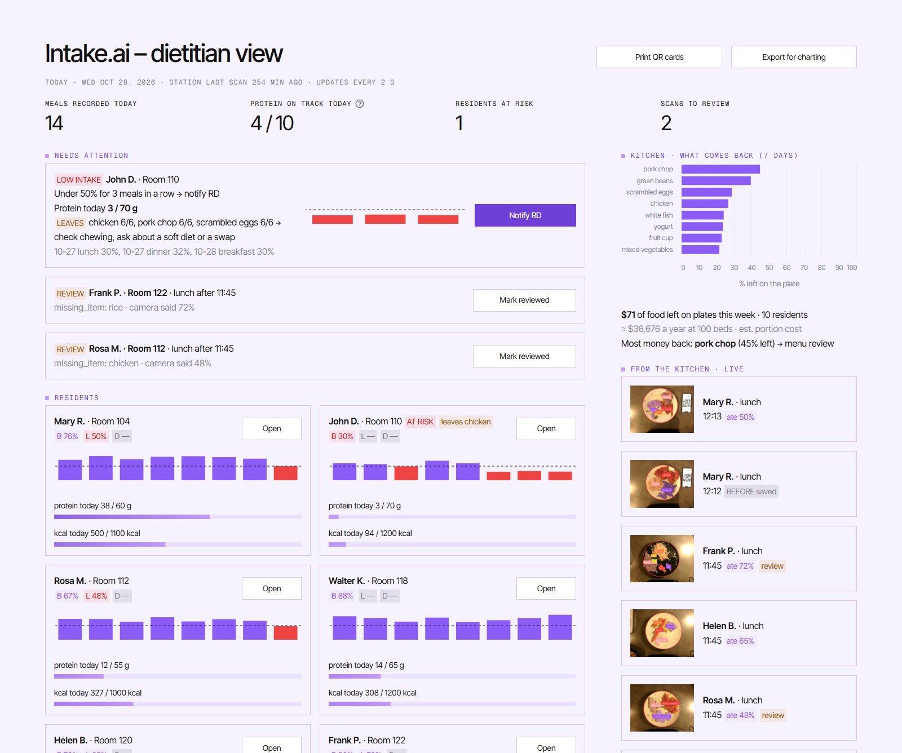
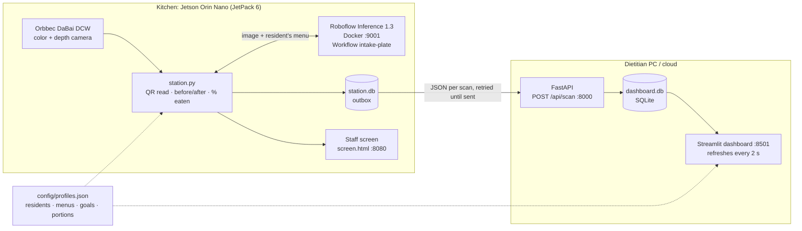
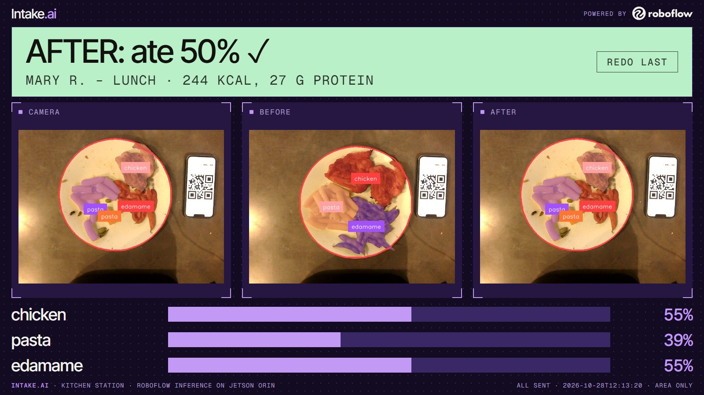
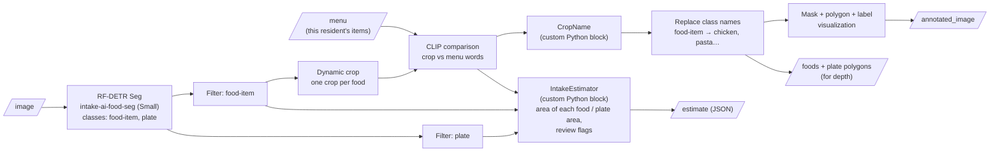
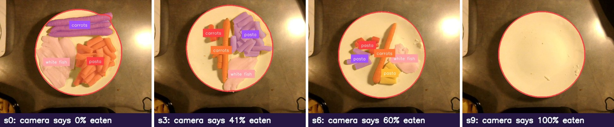
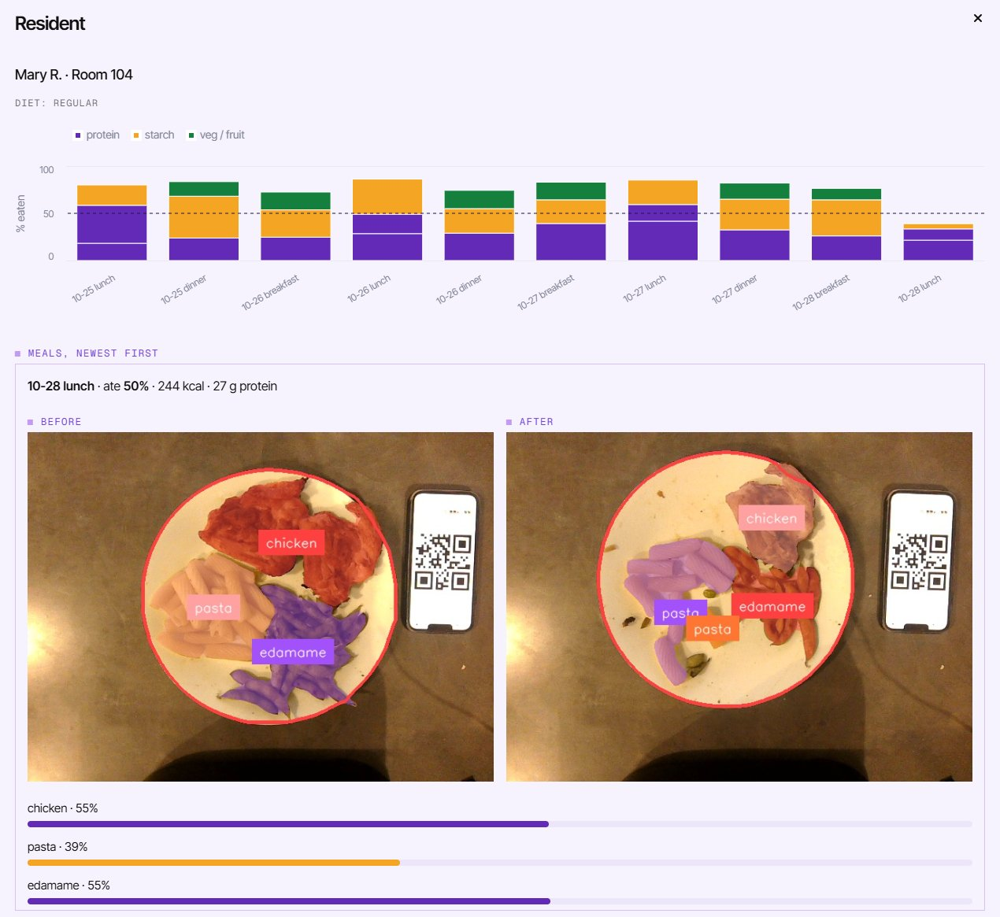

# Intake.ai

**A camera that sees how much of each meal a nursing-home resident ate, and tells the dietitian who needs help.**

Built for the Roboflow Field Engineering tech challenge: our own data, a trained Roboflow model, a
Workflow with custom blocks, deployed on **Roboflow Inference** at the edge (Jetson Orin Nano).



*The dietitian dashboard. John D. left most of his last 3 meals and always leaves the meat, so he is
flagged with a suggested action. Two plates the camera was unsure about wait for review. On the right,
the kitchen sees what food comes back and what it costs.*

---

## Contents
- [The problem](#the-problem)
- [How it works: See → Understand → Act](#how-it-works-see--understand--act)
- [System architecture](#system-architecture)
- [1. See: the kitchen station](#1-see-the-kitchen-station)
- [2. Understand: the Roboflow Workflow](#2-understand-the-roboflow-workflow)
- [3. Act: the dietitian dashboard](#3-act-the-dietitian-dashboard)
- [The model](#the-model)
- [How accurate is it?](#how-accurate-is-it)
- [Known limits and the Active Learning loop](#known-limits-and-the-active-learning-loop)
- [Run it](#run-it)
- [Repo map](#repo-map)

---

## The problem

US nursing homes must assess, monitor and adjust each resident's nutrition (CMS F-tag 692), and
inspectors check the meal intake logs. Weight loss is the federal trigger, but it shows up late;
intake is the early signal. Today an aide looks at the tray after the meal and writes down a guess:
0, 25, 50, 75 or 100%. That guess is:

- **coarse**: one number for the whole plate, so nobody knows *which* food was left;
- **late**: a pattern shows up only when someone reads the charts days later;
- **expensive**: staff time on every tray, every meal, every resident.

Intake.ai takes two photos, one before and one after, and does the rest:

| Staff today | Intake.ai |
|---|---|
| Eyeball guess, whole plate | % eaten **per food**, from masks |
| Paper / EHR entry by hand | Automatic, one QR card per resident |
| Pattern spotted days later | Alert after 3 low meals in a row |
| "Ate 50%" | "Ate 50%: 27 g protein of 60 g goal, leaves the chicken every time" |

Background: [`context/nursing-home-rules.md`](context/nursing-home-rules.md),
[`context/senior-dining-service.md`](context/senior-dining-service.md),
[`context/market-research.md`](context/market-research.md).

---

## How it works: See → Understand → Act

```
  SEE                         UNDERSTAND                          ACT
  ───                         ──────────                          ───
  Plate + QR card     ──►     Roboflow Workflow on the Orin  ──►  Dashboard for the dietitian
  under the camera            • finds the plate and each food     • who is eating less (alert)
  (before and after           • names each food from the menu     • which food they leave
   the meal)                  • measures how much is left         • protein vs goal today
                              • % eaten per food, kcal, protein   • what the kitchen throws away ($)
```

1. **Before the meal** the aide puts the plate and the resident's QR card under the camera and
   presses SCAN. The station saves the BEFORE.
2. **After the meal** the same plate and card go back under the camera. The station runs the
   Workflow again and compares the two scans.
3. The station sends one JSON per scan to the dashboard. The dashboard updates within about 2 seconds.

---

## System architecture



| Piece | Runs on | Tech | Code |
|---|---|---|---|
| Camera | Orbbec DaBai DCW (USB) | OpenCV (color), OpenNI 2 (depth) | [`station/depth.py`](station/depth.py) |
| Model + Workflow | Roboflow Inference container on the Orin (hosted API as fallback) | RF-DETR Seg + CLIP + 2 custom Python blocks | [`workflow/`](workflow/) |
| Station | Orin | Python, OpenCV QR, `inference_sdk`, SQLite outbox, FastAPI screen | [`station/`](station/) |
| Dashboard | Laptop (stands in for the RD's PC / cloud) | FastAPI + SQLite + Streamlit + Altair | [`app/`](app/) |
| Shared shapes | — | 3 JSON contracts | [`docs/contracts.md`](docs/contracts.md) |

**Speed on the Orin:** the 11-step Workflow takes **0.64 s per plate**; the depth reading (10
frames averaged) takes 0.42 s.

**Edge first.** The Workflow runs next to the camera, so photos never leave the kitchen. Only the
numbers and one small annotated picture go to the dashboard. If the network drops, scans wait in
the station's outbox and are sent later. The station can also call Roboflow's hosted
`serverless.roboflow.com` with the same Workflow; one environment variable switches between them.

---

## 1. See: the kitchen station



*The staff screen on the Orin after Mary R.'s lunch: camera, BEFORE and AFTER with the Workflow's
masks, and % eaten per food. (Rebuilt from the real demo scan for this picture; live it shows the
camera feed in the first panel.)*

- **QR card = who.** The card holds only the resident id (`R01`). Name and room are printed under it.
  No names or faces in the image. Cards print from the dashboard ("Print QR cards").
- **SCAN = when.** The station reads the card and greets the resident by name; the aide presses SCAN
  (or the space bar). The station knows whether this is the BEFORE or the AFTER for this resident + meal.
- **REDO LAST** throws away a bad scan and takes it again; the dashboard replaces it.
- **Screen colors**: green = done, amber = unsure (sent for review), red = error (no card, no plate).
- **Depth (optional).** "EMPTY PLATE" saves the plate's shape from the depth camera. After that,
  % eaten = average of area and depth (see [accuracy](#how-accurate-is-it)).

Code: [`station/station.py`](station/station.py) (loop + screen),
[`station/intake.py`](station/intake.py) (meal math), [`station/store.py`](station/store.py) (outbox).

---

## 2. Understand: the Roboflow Workflow

Workflow `intake-plate` (workspace `manchado53`), spec in
[`workflow/intake-plate.json`](workflow/intake-plate.json).



**Why this design:**
- **The model finds "food" and "plate" only; CLIP names the food.** Menus change every day. A model
  trained on 15 dishes breaks on dish 16. CLIP only has to pick among the 3–4 words on *this
  resident's* menu, which is a much easier question ([D1](docs/decisions.md)).
- **Plate area is the ruler.** Each food's area is divided by the plate's area, so the camera height
  and zoom don't matter.
- **The custom block flags doubt.** No plate, a weak detection or a low CLIP score sets
  `needs_review`, and the dashboard puts that plate in the review queue.

The Workflow masks as a real plate gets eaten (meal_03: fish, pasta, carrots):



**% eaten math.** For each food: `pct = 1 − after_area / before_area`. For the plate:
`total = 1 − Σ after_area / Σ before_area`, so a big portion counts more than a small one. kcal and
protein = % eaten × the portion's values from [`config/profiles.json`](config/profiles.json).

Full output shape: [`docs/contracts.md`](docs/contracts.md) §1. Custom block code:
[`workflow/intake_estimator.py`](workflow/intake_estimator.py).

---

## 3. Act: the dietitian dashboard

Every number on the dashboard is tied to someone who can act on it.

| Insight | Who acts | What they do |
|---|---|---|
| **Low intake alert**: under 50% for 3 recorded meals in a row | Registered dietitian | "Notify RD", check the resident |
| **Leaves X**: a food left (< 50% eaten) in ≥ 4 of the last 6 times served | RD / nurse | Check chewing, offer a soft diet or a swap |
| **Protein today vs goal** (only from scanned plates) | RD | Add a supplement before the day ends |
| **Review queue**: plates the camera was unsure about | Kitchen lead | Confirm or fix; fixed images feed the next model (Active Learning) |
| **What comes back** (7 days, % left per food, $ per week) | Kitchen manager | Change a recipe or portion that keeps coming back |
| **Export for charting** (CSV of every recorded meal) | Nurse | EHR / MDS Section K paperwork |

Click a resident to see the trend by food group and every meal with its BEFORE and AFTER pictures:



*Mary R.'s lunch from the live demo: chicken, pasta and edamame, each found and named by the
Workflow. She ate about half, 27 g of protein. Bars are colored by food group: protein, starch, veg/fruit.*

The history before the demo is **synthetic** ([`app/seed.py`](app/seed.py)), with a few planted
patterns so every insight has something to show. Three of today's lunches use real recorded plates
through the real Workflow. Residents are fake.

Code: [`app/dashboard.py`](app/dashboard.py) (page), [`app/insights.py`](app/insights.py) (protein,
leaves-X, waste), [`app/alerts.py`](app/alerts.py) (alert rule), [`app/server.py`](app/server.py) (API).

---

## The model

**RF-DETR Seg Small**, 2 classes (`food-item`, `plate`), trained on MSOE's Rosie GPU cluster (H100)
and deployed through Roboflow as `manchado53/intake-ai-food-seg`.

**Data.** No public dataset has one plate, top-down, before *and* after, with masks *and* weights.
So we made our own and mixed in public data:

| Source | Images | Use |
|---|---|---|
| Ours: our station, 5 staged meals, top-down, weighed on a 1 g scale | 152 (train 89 · valid 30 · test 33, split by meal) | train + the honest test |
| FLIC: Italian school canteen, real leftovers, weighed | 1,845 | train; 341 from 4 unseen days = test |
| MyFoodRepo: home meals, phone photos (kept 987 of ~44k) | 987 | train; 100 random = test |
| **Total in Roboflow (dataset v2)** | **2,984** | |

Labels came from **SAM 3** on Rosie, prompted with the menu words, then fixed rules and contact-sheet
checks ([D2](docs/decisions.md), [D8](docs/decisions.md)).

**Results** (mask mAP50:95 on 3 test sets it never trained on):

| Model | Our unseen meal | FLIC | MyFoodRepo | **Average** |
|---|---|---|---|---|
| v0: our meals only | 0.790 | 0.733 | 0.737 | 0.753 |
| v1: + public sets | 0.877 | 0.852 | 0.874 | 0.868 |
| **v1b: + mild color augmentation (deployed)** | **0.883** | **0.856** | **0.886** | **0.875** |

Public data helped every set, our own test meal too. Bigger model sizes (Medium → XLarge) did
**not** beat Small (Nano 0.855 · Small 0.875 · Medium 0.862 · Large 0.872 · XLarge 0.871), so
Small stays. Training: ~43 min per run on one H100.
Details: [`docs/experiments/2026-10-27-seg-v0-v1-v1b.md`](docs/experiments/2026-10-27-seg-v0-v1-v1b.md),
[`docs/experiments/2026-10-27-seg-sizes.md`](docs/experiments/2026-10-27-seg-sizes.md).

Labels (left) vs model (right) on canteen trays it never saw:


**Naming with CLIP.** CLIP picks each blob's name from the resident's own menu. It names
**88%** of the food blobs right on our meals (126 of 144) and **93%** on 480 public Food-101 photos.
15 of the 18 misses on our meals are small crumbs. Food-101 test
([`docs/clip-menu-test.md`](docs/clip-menu-test.md)):


---

## How accurate is it?

The number that matters is not mAP. It is **how far the camera's % eaten is from the kitchen scale**
([D9](docs/decisions.md)). Every staged meal was weighed at each step on a 1 g scale.

| Method | Avg error vs scale (lower is better) | Reads |
|---|---|---|
| Staff by eye | ≈ 20 pts | high |
| Area only (masks) | 14.5 pts | low |
| Depth, using the plate's real shape | 6.5 pts | high |
| **Average of area and depth (live on the station)** | **5.5 pts** | — |
| Target | ≤ 10 pts | |

*All 5 weighed meals, 42 eaten states. The averaging rule was picked on meals 2–5; meal 1 was held
back and checked after: 3.5 pts. Still one kitchen and staged meals, so the next step is 2–3 new
weighed meals with the code frozen.*

- **Area misses food eaten from the top of a pile** (rice, mashed potatoes): the pile gets lower
  but covers the same space. Depth sees the height drop.
- **The segmentation model is not the bottleneck.** On 126 FLIC dishes our masks give the same
  error as FLIC's own hand-drawn masks (13.5 vs 14.0 points). Better masks won't fix area; depth does.
- Area reads low and depth reads high, so the average cancels most of both. Example plate: scale
  49%, area 39%, depth 58%, average 48.5%.
- Staff estimates read about 20 points high ([`docs/research/success-metrics.md`](docs/research/success-metrics.md)).

Details: [`docs/experiments/2026-10-28-pct-vs-scale.md`](docs/experiments/2026-10-28-pct-vs-scale.md),
[`docs/experiments/2026-10-28-depth-plate-shape.md`](docs/experiments/2026-10-28-depth-plate-shape.md).

Lining the depth camera up with the color camera ([`docs/calibration.md`](docs/calibration.md)):


---

## Known limits and the Active Learning loop

What it does **not** do yet, said plainly:

- **CLIP naming is the weak link.** Segmentation is good; naming similar-looking foods is not.
  Seen on real plates: rice named "green beans", chicken named "mashed potatoes". These plates land in
  the review queue (`missing_item`, `low_clip`). That flag only exists in the demo seed so far.
- **One main plate per scan.** Trays, bowls, drinks and dessert are v2 ([D3](docs/decisions.md)).
- **Small test.** 5 staged meals plus FLIC. Needs a pilot with real residents.
- **Low eaters caught** (target ≥ 90%) is not measured yet. That is the first pilot metric.
- **Depth needs the empty plate saved once** and a camera that sees the plate (shiny or dark spots read as holes).

**How it gets better: Active Learning.** Deploying is the start, not the end ([D4](docs/decisions.md)):

```
 scan ──► Workflow unsure? ──yes──► review queue ──► staff fixes the label ──► Roboflow dataset
   ▲                                                                                  │
   └──────────────── new model version deployed to the Orin ◄──── retrain ◄───────────┘
```

---

## Run it

Three parts. Details in each folder's README.

**Dashboard (laptop)**: [`app/README.md`](app/README.md)
```bash
.venv-app/Scripts/python -m app.seed                                       # synthetic history
.venv-app/Scripts/python -m uvicorn app.server:app --host 0.0.0.0 --port 8000
.venv-app/Scripts/python -m streamlit run app/dashboard.py --server.port 8501
```

**Station without hardware** (fake Workflow, test frames): [`station/README.md`](station/README.md)
```bash
.venv-app/Scripts/python station/make_demo_frames.py
.venv-app/Scripts/python station/station.py --source data/raw/test_station --fake-workflow --meal lunch
```

**Station on the Orin** (Roboflow Inference in Docker on :9001):
[`deploy/orin/README.md`](deploy/orin/README.md), setup in
[`docs/research/orin-setup.md`](docs/research/orin-setup.md)
```bash
cd ~/intake && RESET=1 ./run_station.sh      # fresh start + fullscreen staff screen
```

**Config.** `ROBOFLOW_API_KEY` goes in a gitignored `.env`; never commit it. `INFERENCE_URL` picks
the Orin (`http://localhost:9001`) or hosted (`https://serverless.roboflow.com`).

**Tests**
```bash
.venv-app/Scripts/python -m pytest tests -q
```

**Reset the demo** (fresh dashboard + fresh station):
```bash
rm -f app/dashboard.db && .venv-app/Scripts/python -m app.seed && ssh orin "cd ~/intake && RESET=1 ./run_station.sh"
```

---

## Repo map

| Path | What |
|---|---|
| [`station/`](station/) | Kitchen station: camera → QR → Workflow → before/after → POST |
| [`workflow/`](workflow/) | Roboflow Workflow spec + custom block code |
| [`app/`](app/) | Dietitian dashboard: API, Streamlit page, alerts, insights, seed |
| [`config/profiles.json`](config/profiles.json) | Fake residents, menus, goals, portion kcal / protein / cost |
| [`deploy/orin/`](deploy/orin/) | Scripts on the Orin: start station, kiosk window, timing |
| [`training/`](training/) | Rosie scripts: build dataset, train RF-DETR Seg, score |
| [`eval/`](eval/) | % eaten vs scale, depth vs area |
| [`tools/`](tools/) | Camera preview, measure, capture meals, calibrate depth |
| [`docs/decisions.md`](docs/decisions.md) | Every big call, why, evidence, when to revisit |
| [`docs/experiments/`](docs/experiments/) | One file per experiment |
| [`docs/contracts.md`](docs/contracts.md) | The 3 JSON shapes the pieces share |
| [`context/`](context/) | Challenge brief, nursing-home rules, market research |
| [`plans/`](plans/) | Plain-English plan per task |

Agents working in this repo: start with [`AGENTS.md`](AGENTS.md).
