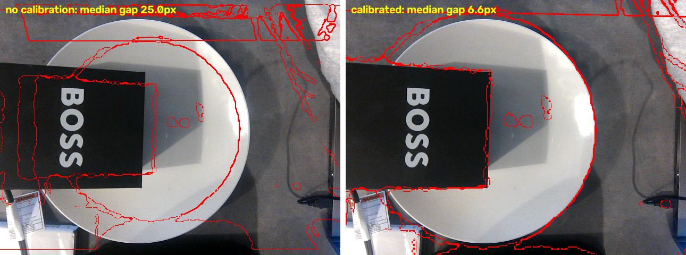

# Depth → color calibration

How the depth image is lined up with the color image, and the math behind it.
Results and dates live in `setup.md`; this file explains the idea.



## Why we need it

The Orbbec DaBai DCW has two "eyes": a color camera and a depth camera. They sit a few cm
apart and the depth eye sees a wider view (~68° vs ~48°). So the same plate lands on
different pixels in the two images:

```
 color image            depth image
+-----------+          +-----------+
|  _______  |          |   ____    |
| / plate \ |          |  /plate\  |
| \_______/ |          |  \____/   |
+-----------+          +-----------+
 plate looks big        plate looks small, shifted
```

The model finds food in the **color** image (mask = which pixels are rice). To get rice
height we read the **depth** image at those same pixels. Without calibration we would read the
plate or the table instead of the rice.

## The simple version: stretch + shift

```
color_x = 1.33 · depth_x − 112
color_y = 1.35 · depth_y −  86
```

- **Stretch (~1.3×):** depth sees wider, so everything is smaller in it and must grow.
- **Shift:** the two eyes are side by side, so the image slides over.

Example, box corner 1: depth (177, 158) → color (123, 127). Clicked in color: (122, 130).

## The full version: a homography

A homography is a 3×3 matrix `H` that maps points on one flat surface seen by camera A to the
same points seen by camera B:

```
| X |   | h11 h12 h13 |   | depth_x |
| Y | = | h21 h22 h23 | · | depth_y |      color_x = X / W
| W |   | h31 h32  1  |   |    1    |      color_y = Y / W
```

Ours (`calib/depth_to_color.json`):

```
| 1.329    0.006   -112 |
| 0.028    1.351    -86 |
| 0.00006  0.00005   1  |
```

- Top two rows: stretch, shift, and a little tilt/twist.
- Bottom row: perspective (far side looks smaller). Near zero here because the camera looks
  almost straight down.

## How H is found

- `H` has **8 unknowns** (the bottom-right is fixed at 1).
- Each clicked pair (same physical point in both images) gives **2 equations** (x and y).
- 4 pairs = 8 equations = exactly one answer. It always fits those 4 points perfectly, so
  its own error (0 px) proves nothing.
- With 8+ pairs there are more equations than unknowns, so OpenCV finds the best fit
  (least squares, with RANSAC to drop bad clicks). The leftover error is then a real quality
  number.

Code: `cv2.findHomography(depth_points, color_points)` in `tools/calibrate.py`.

## How we checked it

The fit's own error can't be trusted with 4 points, so we tested on a **new scene** (box
moved): for every depth edge (a height jump), measure the distance to the nearest color edge.

| | Median gap | Edges within 3 px |
|---|---|---|
| No calibration (plain resize) | 25.0 px | 6% |
| Calibrated | 6.6 px | 35% |

The plate rim was never clicked, yet it lines up (~2–3 px ≈ 1.5 mm at 37 cm). The median is
pulled up by depth edges with no color edge (table, shadows, hole borders).

## Limits (and what we'd do next)

- **One flat plane.** `H` is exact only for the surface the points were clicked on (the box
  top, ~3 cm above the plate). Things at other heights shift a few px (parallax: two eyes see
  a raised object from slightly different angles). Food is low, so the error is small.
- **Few points = can't trust the fit's own error.** The first calibration used 4 points; it
  was redone with 16 spread over the whole view and checked with **leave-one-out** (fit
  without one pair, test on it): median 7.1 px (old) → 4.9 px (new). An **affine** model
  (stretch + shift + tilt, 6 numbers, no perspective row) scored about the same (5.5 px).
- **Camera moves = redo.** If the mount is bumped, `H` is wrong. Idea: check each scan by
  comparing the model's plate edge with the depth rim edge, and flag "needs recalibration".
- **Why it's good enough for now:** % eaten = after / before. The same small offset is in
  both scans, so it mostly cancels. Shrinking food masks a few px also keeps the height
  reading away from edges. Raw images are saved unwarped, so a better calibration can be
  re-applied later without reshooting.
