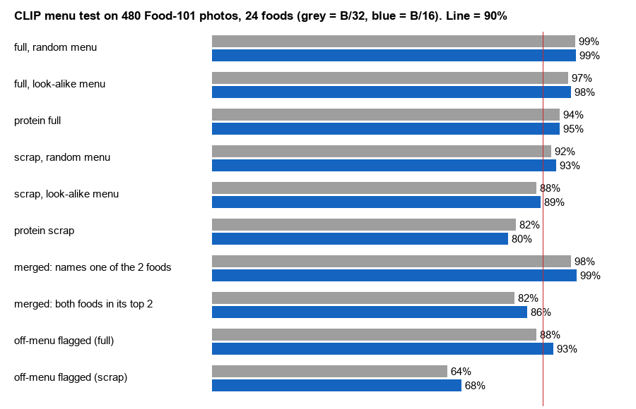
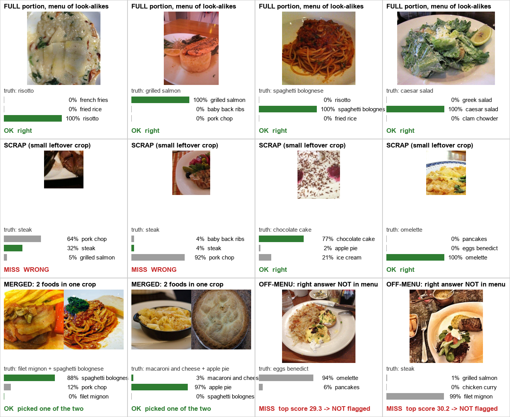

# CLIP menu test: can CLIP name the foods if it only picks from the menu?

Run on 2026-10-25 to de-risk the naming step before we have our own photos.
Code and raw numbers: `research/clip_menu_test/` (`results2.json`).

## The question

The plan: a segmentation model cuts each food out of the plate (class-agnostic `food-item`), then
CLIP names each crop. CLIP does not choose from every food in the world, only from **that meal's
tray-ticket menu** (3–4 items). Is CLIP good enough at that, and where does it break?

```
plate photo -> seg model -> crop per food -> CLIP: "which of THESE menu items is it?"
                                                    (chicken / pasta / peppers)
```

## Setup

- **Images:** Food-101 validation set (public web food photos), 24 classes picked to look like a
  nursing-home menu, 20 photos each = **480 photos**.
  - protein: pork chop, steak, filet mignon, grilled salmon, chicken wings, chicken curry, baby back ribs
  - starch: fried rice, risotto, mac & cheese, spaghetti bolognese, lasagna, french fries
  - breakfast: omelette, eggs benedict, pancakes
  - salad/soup: caesar salad, greek salad, clam chowder
  - dessert: apple pie, carrot cake, chocolate cake, cheesecake, ice cream
- **Models:** OpenAI CLIP ViT-B/32 and ViT-B/16 (Hugging Face `transformers`), CPU only.
- **Prompt:** `"a photo of {food}, a type of food"` scored best of 4 prompt styles.
- **Cases** (each one fakes a real situation):

| Case | How it was made | Real situation |
|---|---|---|
| Full, random menu | whole photo; menu = truth + 2–3 random foods | full plate, varied menu |
| Full, look-alike menu | menu = truth + foods from the **same group** (e.g. 3 proteins) | hardest realistic menu |
| Scrap | random crop of 15–25% of the photo, shrunk 2× | small leftover after eating |
| Merged | 2 food photos glued side by side | seg model merges 2 touching foods |
| Off-menu | truth left **out** of the menu; flag if CLIP's top score < a threshold | food not on the ticket |

## Results



| Case | ViT-B/32 | ViT-B/16 |
|---|---|---|
| Full, random menu | 99% | 99% |
| Full, look-alike menu | 97% | 98% |
| Protein only, full | 94% | 95% |
| Scrap, random menu | 92% | 93% |
| Scrap, look-alike menu | 88% | 89% |
| Protein only, scrap | 82% | 80% |
| Merged: names one of the 2 foods | 98% | 99% |
| Merged: both foods in its top 2 | 82% | 86% |
| Off-menu flagged, full (keeping 95% of on-menu answers) | 88% | 93% |
| Off-menu flagged, scrap | 64% | 68% |

Speed on the laptop CPU: B/32 ~12 crops/s, B/16 ~4 crops/s. A plate has ~3–5 crops, so even on
CPU it is ~1 s; on the Orin GPU it should be far less (not measured yet).

### Random examples (B/16, not cherry-picked, misses included)



Green bar = right answer. In this draw: 4/4 full plates right; 2/4 scraps right (both steak scraps
called "pork chop"); merged crops name one food, never both; both off-menu cases were **not**
flagged (CLIP was confidently wrong).

## What it means

| Job | Verdict | Plan |
|---|---|---|
| Name foods on the **before** plate | Solved if segmentation gives one crop per food | CLIP + menu, ViT-B/16 |
| Name foods on the **after** plate (scraps) | CLIP alone not good enough, worst on protein | Match each leftover to the before food in the **same spot** (try plate rotations); CLIP only breaks ties |
| Two foods merged in one crop | CLIP silently picks one | Seg model must split touching foods (instance masks) |
| Food not on the menu | Missed about 1 in 3 on scraps | Score threshold + flag for human review, never a silent number |

**Bottom line:** with good segmentation and the menu, naming is not the risk. The risk moves to
the after-scan matching and to depth volume.

## Limits (be honest about these)

- **Wrong look:** web photos are styled, side-angle, well lit. Our camera is top-down under a
  lamp. These numbers are a **best case** until rerun on our own shots (`data/raw/meal_*`).
- **Fake scraps:** a random crop is not real eaten food (smeared, picked-at, mixed with sauce).
- **Small sample:** 20 photos per food; a few % up or down is noise.
- **Threshold from this data:** the off-menu cut-off (~27–28 on 100× cosine) must be re-fit on ours.

## How to rerun

```
cd research/clip_menu_test
python -m venv venv
venv/Scripts/pip install torch transformers pillow numpy requests
venv/Scripts/python fetch_data.py 20          # downloads 20 Food-101 photos per class into data/
venv/Scripts/python eval2.py ViT-B-32 ViT-B-16  # all cases -> results2.json
venv/Scripts/python show.py                   # clip-examples.png + clip-results.png
```

Versions used: torch 2.14.1+cpu, transformers 5.20.2, numpy 2.4.6, pillow 12.3.0.
On Windows, torch can fail with `WinError 206` (path too long) if the folder is deep; map it to a
short drive first (`subst Q: <folder>`, run from `Q:\`, then `subst Q: /D`).

## Next

Rerun the same cases on our own crops once meal_01+ are labeled: full plate (s0) vs leftovers (s3–s4),
with the real menu from the ticket.
