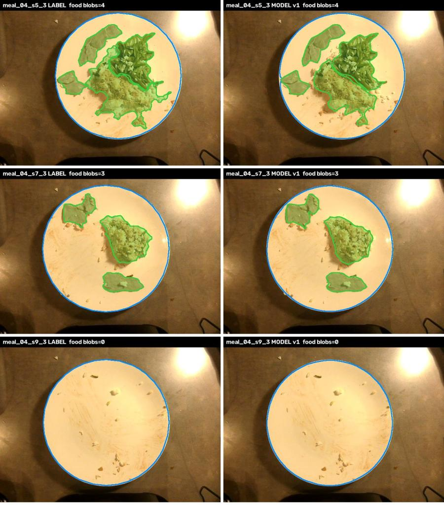
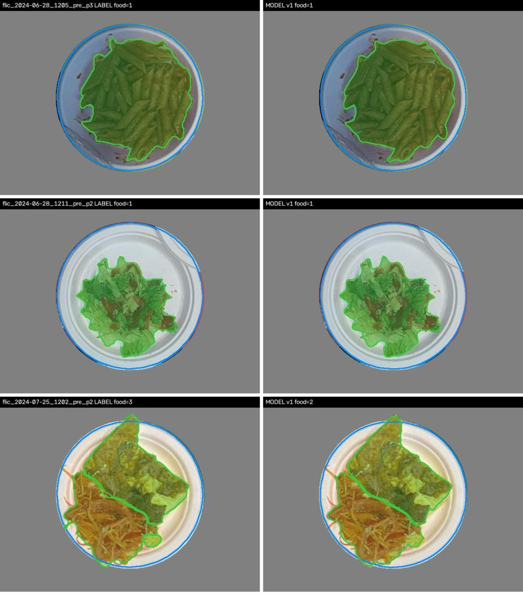
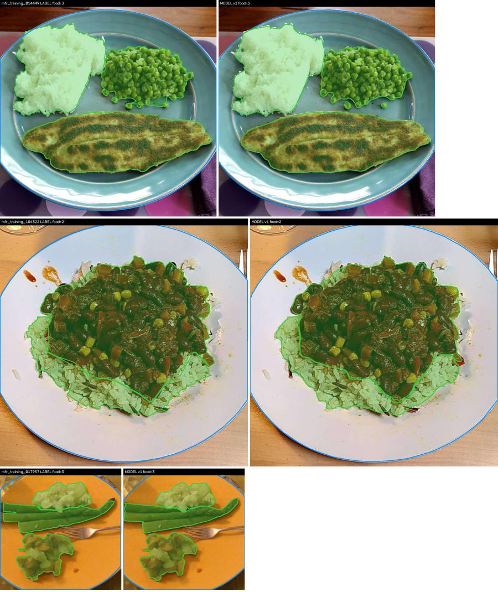

# Seg model, first run: v0 vs v1 vs v1b (2026-10-27)

**Question:** does public data (FLIC + MyFoodRepo) help or hurt on our plates? Does mild
colour augmentation help? (D5 / D8 "revisit if")

**Answer:** public data helps a lot (+0.09 to +0.13 mask mAP on every unseen set, our own
test meal included). Augmentation adds a little. **v1b is the current best model.**

## Results

segm mAP50:95 = mask fit (COCO style, 0-1). "Count exact" = share of images where the number of
predicted food blobs (conf >= 0.5) equals the labelled number.

| Model | Train data | meal_04 valid | meal_03 test | FLIC holdout | MFR holdout |
|---|---|---|---|---|---|
| v0 | our meals only (89 img) | 0.896 | 0.790 / 45% | 0.733 / 60% | 0.737 / 45% |
| v1 | + FLIC + MFR (2,464 img) | 0.915 | 0.877 / 76% | 0.852 / 83% | 0.874 / 78% |
| **v1b** | v1 + `AUG_CONSERVATIVE` | **0.915** | **0.883 / 79%** | **0.856 / 82%** | **0.886 / 85%** |

Cells: mask mAP50:95 / count exact. Valid has no count column (all three hit precision = recall = 1.0).

| Set | Images | What it tests |
|---|---|---|
| meal_04 (valid) | 30 | same kitchen as training; also used to pick the best epoch, so optimistic |
| meal_03 (test) | 33 | our station, a meal never trained on (fish, pasta, carrots): the honest number |
| FLIC holdout | 341 | 4 canteen days never trained on (trays, other plates, other light) |
| MFR holdout | 100 | home photos never trained on (any plate, any angle) |

Train time on one H100: v0 11 min, v1 45 min, v1b 43 min (50 epochs each).

## What the masks look like

Left = label, right = v1. Green = food, blue = plate.

- Good: separate foods split cleanly where they touch (rice / beans, chili / rice); empty plate =
  0 food; crumbs and smears ignored; food over the rim kept.
- Misses: small lone pieces dropped (FLIC 07-25: 3 blobs -> 2); touching pieces of one food
  sometimes split (MFR bananas: 2 -> 3).
- Model edges are smoother than SAM 3 labels (skips rice wisps), so food area may read slightly
  low. The % eaten vs scale check will show if that matters.

## Limits

- One run per variant, one seed; v1 vs v1b gap (~0.01) is within noise.
- meal_03 labels are SAM 3 + rules, not hand-drawn; scores are agreement with those labels.
- % eaten vs scale not measured yet (next step).

## Setup (to reproduce)

- Data: Roboflow `manchado53/intake-ai-food-seg` version 2 (auto-orient only, no augmentation),
  COCO export. Train = meal_01/02/05 + FLIC + MFR minus `holdout:*` and `exclude` lists;
  valid = meal_04; test = meal_03.
- Model: `RFDETRSegSmall`, 50 epochs, batch 8, grad accum 2, defaults otherwise; best-total EMA
  checkpoint (picked on meal_04).
- Eval: supervision `MeanAveragePrecision(metric_target=MASKS)`, predictions at conf >= 0.3.
- Env (Rosie, `dgxh100`): rfdetr 1.11.2, torch 2.11.0, supervision 0.31.2, albumentations 2.0.8.
- Scripts: `training/train_variant.py`, `training/overnight.sbatch`, `training/eval_pub.py`,
  `training/eval_pub.sbatch`, `training/viz04.py`. Slurm jobs 289444 (train), 289602 (eval).
- Weights: Rosie `~/intake-train/runs/{v0,v1,v1b}/checkpoint_best_total.pth` (not in git).

## Next

1. % eaten vs scale on meal_03 (the number nursing staff care about).
2. Upload v1b weights to Roboflow; build the Workflow.
